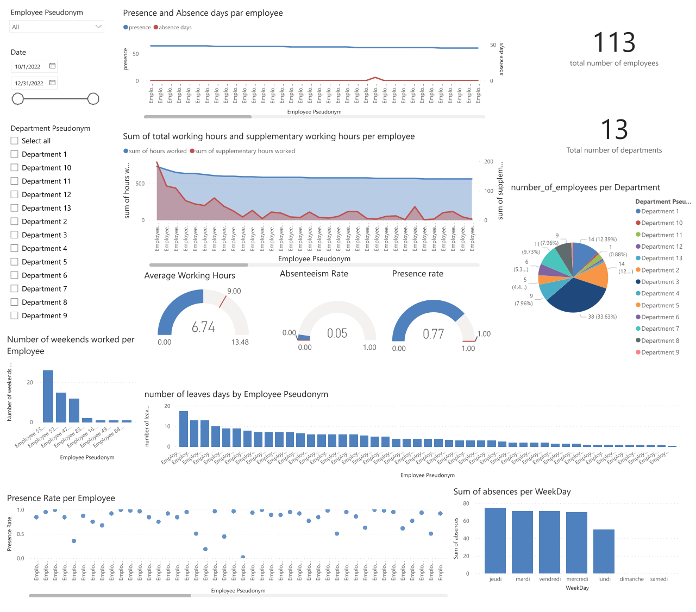

# HR Harmony – Tableau de bord RH sous Power BI

Projet BI de bout en bout sur des **données RH réelles et anonymisées d'une entreprise tunisienne**. Un pipeline ETL en Python rassemble quatre sources brutes dans un modèle en étoile sous PostgreSQL, puis un tableau de bord Power BI suit la présence, l'absentéisme, le temps de travail et les congés, au niveau de l'employé, du département et de l'entreprise.

## Données

- **4 sources** : base des employés (SQL), pointages quotidiens, absences et congés (fichiers Excel)
- **Périmètre** : 113 employés, 13 départements, d'octobre à décembre 2022 (65 jours ouvrés)
- **Confidentialité** : les données brutes ne sont pas publiées ; les noms des employés et des départements sont remplacés par des pseudonymes

## Pipeline ETL (`etlprocess.ipynb`)

1. Conversion des fichiers Excel en JSON
2. **Rapprochement des noms d'employés entre les fichiers** par correspondance floue (RapidFuzz, seuil de similarité de 70), car une même personne était orthographiée différemment selon la source
3. Standardisation des dates (`AAAA-MM-JJ`) et des heures (`HH:MM:SS`)
4. Calcul du temps de travail et des heures supplémentaires par jour, ainsi que de la durée des congés (demi-journées comprises)
5. Construction de la table de faits et des dimensions, puis chargement dans PostgreSQL

## Modèle de données (schéma en étoile)

| Table | Lignes | Contenu |
|---|---|---|
| `hrfact` | 6 264 | Une ligne par employé et par jour : présence, absence, congé, week-end, temps de travail, heures supplémentaires |
| `employeedimension` | 113 | Identifiant de l'employé, département, pseudonyme |
| `departmentdimension` | 13 | Identifiant du département, effectif, pseudonyme |
| `datedimension` | 92 | Date, jour, mois, jour de la semaine, indicateur de week-end |

## Tableau de bord (`projectbi.pbix`)

Le rapport repose sur **15 mesures DAX** : taux d'absentéisme, taux de présence, heures moyennes travaillées, jours et taux de congé.

Les principales mesures sont **dynamiques selon le contexte** : grâce à `HASONEVALUE`, une même mesure renvoie la valeur individuelle quand un employé est sélectionné, la moyenne du département quand un département est sélectionné, et la moyenne de l'entreprise sinon.

**Visuels** : jauges (heures moyennes, taux d'absentéisme, taux de présence), présence et absences par employé, heures travaillées et heures supplémentaires, effectif par département, week-ends travaillés, jours de congé par employé, taux de présence par employé et absences par jour de la semaine, avec des filtres par employé, par département et par période.

## Principaux résultats (4e trimestre 2022)

- **6,7 heures** travaillées en moyenne par jour et par employé
- Taux d'absentéisme moyen de **4,6 %** sur 65 jours ouvrés
- **Toutes les absences enregistrées se concentrent dans 5 des 13 départements**
- Plus de **1 900 heures supplémentaires** sur le trimestre
- Le **lundi** est le jour avec le moins d'absences ; elles sont nettement plus nombreuses du mardi au vendredi

## Outils

Python (Pandas, RapidFuzz) · PostgreSQL · Power BI (DAX) · Google Colab

## Ouvrir le projet

- **ETL** : ouvrir `etlprocess.ipynb` dans Google Colab ou Jupyter (les fichiers bruts ne sont pas fournis)
- **Tableau de bord** : ouvrir `projectbi.pbix` avec Power BI Desktop
